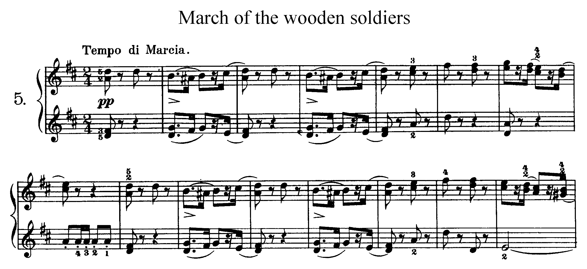
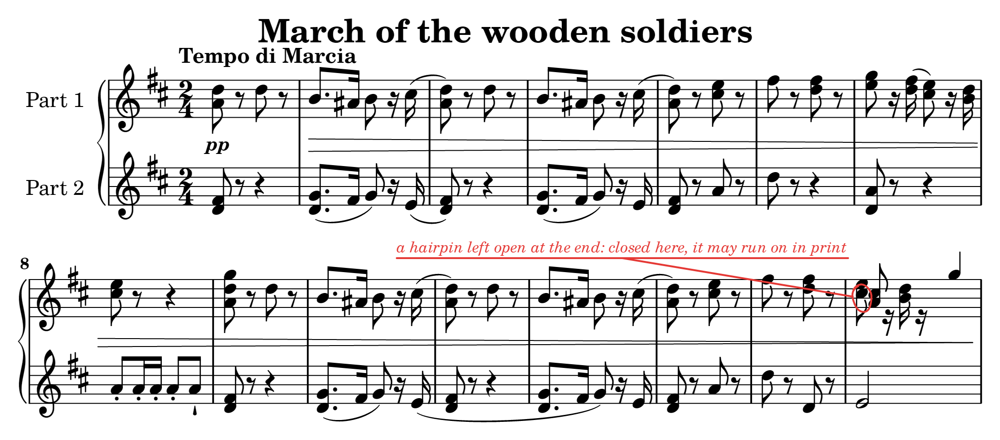
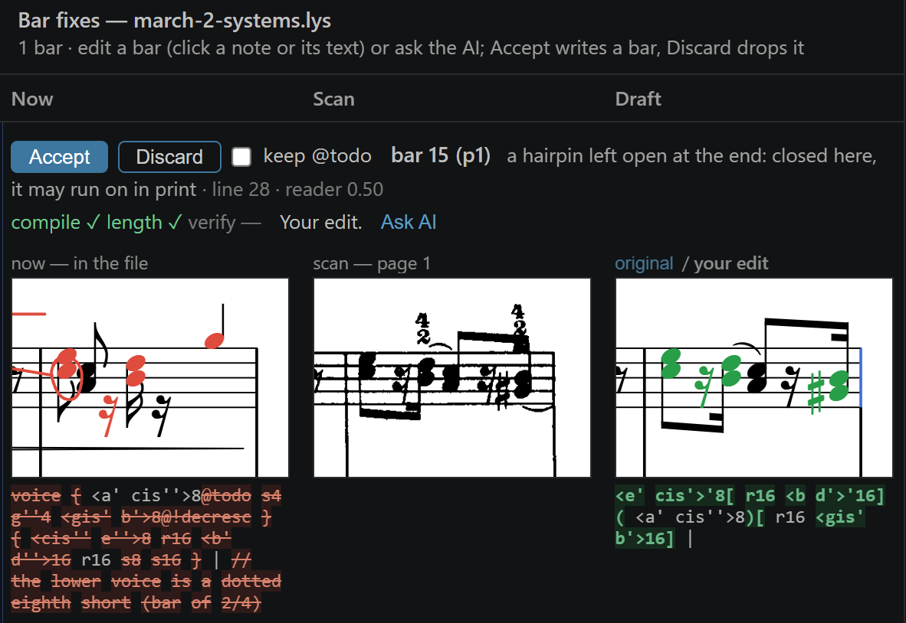

# Lily# Scan Import (LilySharp-Omr)

Optical music recognition for [Lily#](https://yotsuda.github.io/LilySharp/): reads a page image or
a PDF of printed sheet music and writes editable Lily# text (`.lys`), with the places it is unsure
of marked for a look. Everything runs on your computer: a small learnt symbol detector (ONNX), the
rules of notation and Windows' own text recognition read the page; nothing is sent anywhere, and
no large language model is involved.





*Above: Tchaikovsky, Album for the Young, Op. 39 No. 5, G. Schirmer 1904 (public domain, from
IMSLP). Below: the reader's `.lys` for the same bars, drawn by Lily#. Red marks the place it asks
you to check: the last bar of the right hand, read wrong.*



*Correcting that marked bar (bar 15 of the right hand) in Lily#: the bar as read (left) opens
beside the same bar on the scan (middle), and the draft (right) is edited by hand or with an AI
model; it shows whether it compiles, fills its bar and matches the scan before Accept writes it.*

## Use it

The reader ships as the VS Code extension
[**Lily# Scan Import**](https://marketplace.visualstudio.com/items?itemName=yotsuda.lilysharp-omr)
(Beta, Windows x64), which works with the
[Lily#](https://marketplace.visualstudio.com/items?itemName=yotsuda.lilysharp) extension: right-click
an image or a PDF and choose *Convert Image/PDF to Lily# (.lys)… (Beta)*. The extension's
[README](extension/README.md) says what it reads, what it does not yet, and how to correct a
reading against the scan.

What it reads, in short: staves and groups of staves, clefs, key and time signatures, notes, chords,
rests, dots, accidentals, beams, tuplets, ties and slurs, grace notes, several voices on a staff,
multi-bar rests and percent repeats, tremolos, octave lines, guitar and bass TAB, drums, dynamics,
hairpins, pedal marks, articulations and ornaments, trills, arpeggios, glissandi, repeats and
endings, common words of expression, the tempo, the title, composer and poet, and rehearsal marks.
Not yet: lyrics, chord names, handwritten music.

## How well it reads

The evaluation sets are 66 readings of piano pieces and songs, some of them the same music in
different editions, that the reader is never tuned on; all are public domain or under a free
license (`data/eval`; the numbers are in [docs/eval-sets.tsv](docs/eval-sets.tsv); three editions
are downloaded by hand, see [data/LICENSES.md](data/LICENSES.md)). A note or rest counts when its
pitch and duration match the truth.

| Pages | Sets | Notes and rests | Read right |
|---|---|---|---|
| Engraved with MuseScore (OpenScore Lieder) | 31 | 25,605 | 96.6% |
| Engraved with LilyPond (Mutopia) | 8 | 2,959 | 94.1% |
| Other modern engravings (Dorico, abcm2ps and others, from IMSLP) | 7 | 2,374 | 93.2% |
| Scans of 19th- and early 20th-century prints (IMSLP) | 20 | 27,333 | 91.5% |
| All | 66 | 58,271 | 94.0% |

A one-page LilyPond PDF reads in a few seconds; an old print scanned small, or a long PDF, takes
longer. The marks are not a proof: a bar with no mark can still be wrong.

## Build and run

Needs Windows 10 version 2004 (build 19041) or later, x64, and the .NET 10 SDK.

```
dotnet build src/Omr -c Release
src\Omr\bin\Release\net10.0-windows10.0.19041.0\omr.exe read data\eval\chopin28-4\src\Chop-28-4a-a4.pdf --out out\try
```

`omr read` takes PNG, JPEG, BMP, TIFF and PDF pages of one piece, in order, and writes `x.lys`,
`x.omr.json` (where each bar is on the page, and the todos) and `x.omr-pNN.png` (the pages with the
marks boxed). `--verify` draws the `.lys` again and checks it against the pages bar by bar; it
needs `lysc`, Lily#'s command line compiler, on the PATH or given with `--lysc` (it is built from
the [Lily# repository](https://github.com/yotsuda/LilySharp), and the Lily# extension carries one).
`omr --version --json` says what this build can do.

How the reading goes in more detail: [docs/reader.md](docs/reader.md) (voices, words over the
music, braces and brackets). What `omr read` and `omr verify` write and print, for a program that
calls them: [docs/protocol.md](docs/protocol.md).

## The repository

| Folder | What is in it |
|---|---|
| `src/Omr` | the reader (`omr.exe`) |
| `src/OmrGen` | the generator of pieces with their truth, drawn by Lily#, for training and testing |
| `src/OmrDegrade` | makes a clean page look printed and scanned |
| `tools` | the regression gate (`check.ps1`), the runs of each set, packing the extension; `train-model/` trains the detector (Python 3.12, PyTorch with CUDA; see its `requirements.txt`) |
| `data` | the evaluation and development sets, the detector (`detector.onnx`) and its tables |
| `extension` | the VS Code extension that carries the reader |
| `docs` | the development log: [ROADMAP.md](docs/ROADMAP.md) and [HANDOFF.md](docs/HANDOFF.md) (in Japanese), the notes exchanged with Lily# (`docs/repro`) |

`tools/check.ps1` is the regression gate: the generated sets and the real benchmarks against
`docs/baseline.json` (`-Detector`: `docs/baseline-detector.json`). The tools that turn the
evaluation PDFs into pages use PyMuPDF (AGPL-3.0).

## Contributing

The most useful help is a page the reader gets wrong: please open an issue with the page (one you
may share), what it wrote and what the page says. See [CONTRIBUTING.md](CONTRIBUTING.md).

## License

The code is under the [Apache License 2.0](LICENSE) (see also [NOTICE](NOTICE)). The data under
`data/` keeps the licenses of its sources: public domain, CC0, CC BY 4.0, and LilyPond's GPL for
the `event-listener*.ly` files; [data/LICENSES.md](data/LICENSES.md) lists each.
